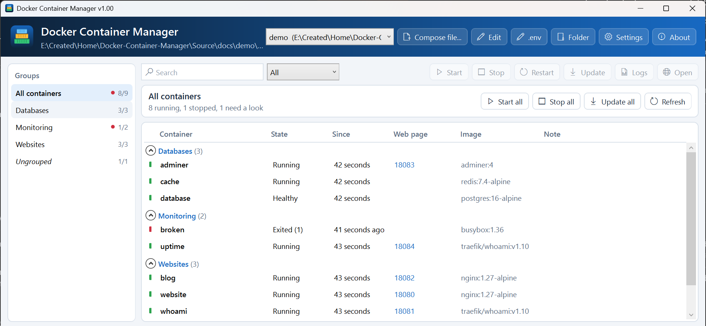

<p align="center">
  
</p>

# Docker Container Manager

Run and organise the containers in your Docker Compose file, in groups, from one Windows window.

    

## ✨ Features

A PowerShell/WPF front end for `docker compose`, made for compose files with dozens or hundreds of services.

- **Every service at a glance**: live state (running, healthy, unhealthy, stopped, exited with an error, not created), how long it's been up, its web page, its image and a note when something needs doing. The list refreshes every few seconds.
- **Groups that live in the compose file.** Add a `home.group` label to a service and it's listed under that group, with running/total counts and a red dot when something in the group has a problem. The labels travel with the file, so every machine you copy it to shows the same groups.
- **Start, Stop, Restart, Update and Recreate** for one container, a selection, a whole group or everything. Update pulls the newest images and recreates what changed, keeps stopped containers stopped, and can tidy away unused images afterwards.
- **Keeps up with the compose file.** Save the file (or `.env`) and it's read again straight away:
  - new services appear,
  - removed services that still have a container are listed under **Not in compose file**, ready to stop or remove,
  - edited services are marked **Changed** until you press **Apply changes**.
- **One click to a container's web page**, from its first published port or a `home.url` label.
- **Logs window** with follow, timestamps, search, copy and save.
- **Check compose file**: finds broken `${...}` variables, spacing mistakes (tabs, uneven indents, a setting indented into the wrong section, a missing space after `:` or `-`), host ports used twice, duplicate names, `depends_on` pointing at nothing, values missing from `.env`, missing folders, services without a group, unpinned images and passwords written in the file. Double-click a result to open the file at that line. The header button shows how many errors and warnings there are.
- **Activity log** showing every docker command it runs and what Docker said, with Cancel.
- **Tray icon** with Start and Stop for each group.
- **Helpful banners** when Docker isn't running (with **Start Docker Desktop**), when the compose file has an error (the last good list stays), or when a folder has `Env_*` templates but no `.env` yet.
- Never edits your compose file. Nothing is installed; settings are in `%APPDATA%`. The exe is self-contained.

## 🖼️ Screenshots



The screenshot uses the demo project in [`docs/demo/`](docs/demo/docker-compose.yml).

## 📋 Requirements

- Windows 10 or 11 with Windows PowerShell 5.1 (or PowerShell 7).
- [Docker Desktop](https://www.docker.com/products/docker-desktop/) (or another Docker engine that `docker.exe` can reach) with Compose v2.20 or later.
- A `docker-compose.yml` (or `compose.yaml`).

## 📦 Installation

**Exe:** download `Docker Container Manager v1.00.exe` from the [latest release](../../releases/latest) and run it. Put it in `Home\Docker-Container-Manager\Builds\` and the Home Launcher lists it under Windows.

**Script:** clone this repo and run `Start Docker Container Manager.cmd`. It starts `src\Docker-Container-Manager.ps1` with the execution policy bypassed for that run only.

### Build the exe

Double-click `Build-Exe.cmd`. It checks the version in the script matches the newest CHANGELOG entry, runs PSScriptAnalyzer (if installed), pastes the icon and logo into the script and compiles it with [ps2exe](https://github.com/MScholtes/PS2EXE) (`-STA -noConsole`). The result is saved to the project's `Builds\` folder, outside the repo, as `Docker Container Manager v<version>.exe`. It installs ps2exe for your user the first time and logs to `Build-Exe.log`.

The exe is not signed by this script. Once `E:\Created\_shared\Build-Tool.ps1` is in place it replaces `Build-Exe.cmd` and signs the exe:

```powershell
E:\Created\_shared\Build-Tool.ps1 -Project "E:\Created\Home\Docker-Container-Manager"
```

## 🚀 Usage

1. Start the app and press **Compose file...** to pick your `docker-compose.yml`. Next time it opens the same file; the list at the top switches between files you've used.
2. Pick a group on the left, or **All containers**.
3. Select one or more containers (Ctrl+click, Shift+click or Ctrl+A) and press **Start**, **Stop**, **Restart**, **Update** or **Logs**, or right-click for **Recreate**, **Copy name** and **Remove container...**.
4. Use **Start group**, **Stop group** and **Update group** in the bar above the list for the whole group. With **All containers** picked they act on everything, after asking.
5. Press **Edit** to change the compose file. When you save, the list updates, and anything that needs recreating shows **Apply changes**.

To try it without your own containers, open `docs\demo\docker-compose.yml` and press **Start all**. `docker compose down` in that folder removes the demo again.

| Key | Does |
| --- | --- |
| F5 | Read the compose file and status again |
| Ctrl+F | Search by name, image, group or port |
| Ctrl+L | Logs of the selected container |
| Enter, double-click | Open the selected container's web page (double-click opens the logs if it has none) |
| Ctrl+A | Select everything in the list |
| Esc | Clear the search |

What each action runs:

| Button | Docker command |
| --- | --- |
| Start | `docker compose up -d <services>` (creates them if needed, and starts what they depend on) |
| Stop | `docker compose stop <services>` |
| Restart | `docker compose restart <services>` |
| Update | `docker compose pull`, then `up -d --no-deps` for running ones and `up --no-start --no-deps` for stopped ones, then `docker image prune -f` (optional) |
| Apply changes, Recreate | The same as Update without the pull (Recreate adds `--force-recreate`) |
| Remove container | `docker rm -f <container>` (images, volumes and data folders are kept) |

## ⚙️ Configuration

### Labels in the compose file

Groups and links come from labels on each service. The `home` prefix can be changed in Settings.

```yaml
services:
  navidrome:
    image: deluan/navidrome
    container_name: navidrome
    labels:
      - home.group=Music
      - home.url=http://localhost:8090/app
      - home.description=Music streaming server
    ports:
      - 8090:4533
```

| Label | Does |
| --- | --- |
| `home.group` | The group the service is listed under. Services without it are under **Ungrouped**. |
| `home.url` | The container's web page. Without it the app uses `http://localhost:<first published port>`. `home.url=none` hides the link. |
| `home.description` | Tooltip for the service in the list. |

Adding or changing a label counts as a change to the service, so the app marks it **Changed** and **Apply changes** recreates it once.

### Settings

**Settings** in the header sets the label prefix, how often the status is checked (15 seconds by default, 30 when the window is in the tray), the editor for **Edit** and **.env** (Visual Studio Code at `C:\Program Files\Microsoft VS Code\code.exe` by default, Notepad when it's empty or not found), whether Update removes unused images, whether stopping a group asks first and whether minimising hides the window in the tray instead of the taskbar (off by default).

They are saved in `%APPDATA%\Docker Container Manager\settings.json`, together with the compose file in use, the recent files list and the window size. Delete the file to start again.

Start the exe (or the script) with `-ComposeFile "<path>"` to open a particular compose file.

## 📝 Changelog

See [CHANGELOG.md](CHANGELOG.md).

## 📄 Licence

MIT, see [LICENSE](LICENSE). Copyright (c) 2026 Jason Rhodes.

Docker and Docker Compose are trademarks of Docker, Inc. This project is not affiliated with or endorsed by Docker, Inc.
